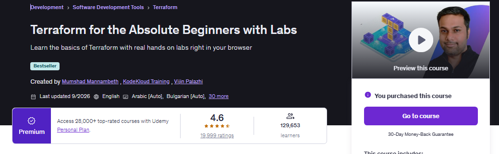
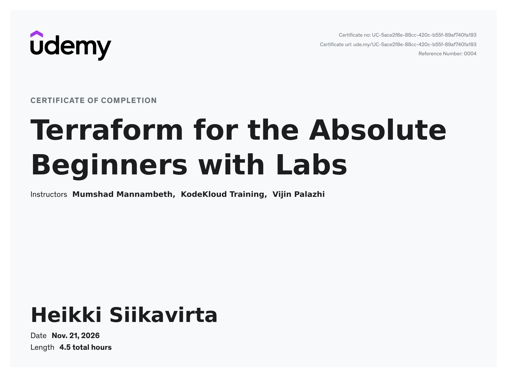

    
     
    Attempt to study <b>IaC</b> and <b>DevOps</b> related things!

 

    

- For these courses one should configure **GIT** for handle projects.
    - `git config --global http.postBuffer 524288000`.
    - `git config --global core.longpaths true`.

# Terraform for the Absolute Beginners with Labs.

<!-- 

    

 -->

    

 

All course material from *Terraform for the Absolute Beginners with Labs* by from **Mumshad Mannambeth**, **KodeKloud Training** and **Vijin Palazhi**.

> At🌍 **Nordea** 🌍, where the need for Terraform and **I**nfrastructure **a**s **C**ode (**IaC**) highlighted the importance of infrastructure automation, cloud provisioning, and managing resources efficiently. It made me realize how essential tools like Terraform are in building, maintaining, and scaling modern cloud environments. 🐟
> 
> That journey strengthened my understanding of how infrastructure can be managed just like application code: consistently, reliably, and repeatably. It also encouraged me to explore the broader DevOps and cloud ecosystem, turning a technical requirement into an opportunity for continuous learning. 🐟    ~ DevelopersCradle

Contains my own with my own visual notes ✍️ with some course material to enforce learning experience.

This repository is made with  with  hotkeys, therefore it will include configuration files which are related to this IDE this approach will be favored for now. ⚙️

We are using . Instead, the which are recommended!

[Udemy course](https://www.udemy.com/course/terraform-for-the-absolute-beginners).

[Homepage of maker](https://kodekloud.com/).

If the content sparked :fire: your interest, please consider starting the course and start learning :book:.

<!-- 
Linkedin puts this shit front, when clicking from private mode x(. Need to put this to make jump working every case
?trk=public_profile_see-credential 
-->

    
    

**Note: The material provided in this repository is only for helping those who may get stuck at any point of time in the course. It is very advised that no one should just copy the solutions(violation of Honor Code) presented here.**

#### Progress/Curriculum.

- [x] [Section 01](#) - Introduction. ✅
- [x] [Section 02](#) - Introduction to Infrastructure as Code. ✅
- [x] [Section 03](#) - Getting Started with Terraform. ✅
- [x] [Section 04](#) - Terraform Basics. ✅
- [x] [Section 05](#) - Terraform State. ✅
- [x] [Section 06](#) - Working with Terraform. ✅
- [x] [Section 07](#) - Terraform with AWS. ✅
- [x] [Section 08](#) - Remote State. ✅
- [x] [Section 09](#) - Terraform Provisioners. ✅
- [x] [Section 10](#) - Terraform Import, Tainting Resources and Debugging. ✅
- [x] [Section 11](#) - Terraform Modules. ✅
- [x] [Section 12](#) - Terraform Functions and Conditional Expressions. ✅

#### Additional stuff.

- Todo

#### The Quizzes and Labs.

* **Section 02**:
    * *Example*:
    * *Logs*:

