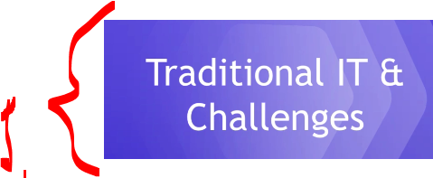
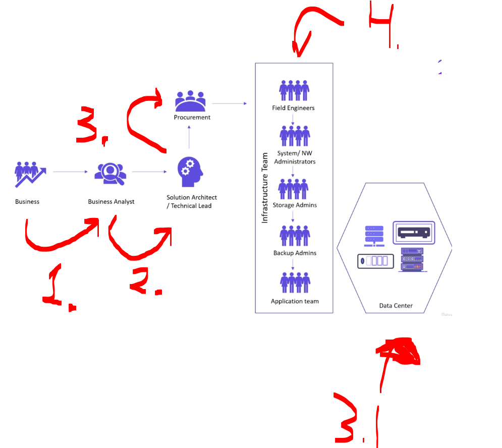
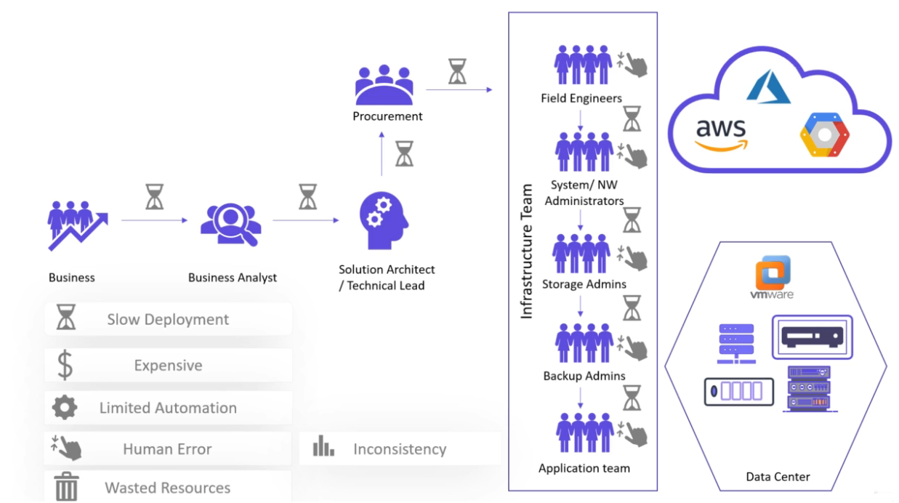

# Chapter 02 - Introduction to Infrastructure as Code. ✅

Introduction to Infrastructure as Code.

# What I learned.

# Challenges with Traditional IT Infrastructure.

    

1. Let's look what are the challenges in the traditional IT model challenges!

    

1. **Business** first collects the **requirements** for the **application**!
2. **Business Analyst** the defines the goals and passes them to **solution Architect**!
    - Architect defines the **architectural rules** to follow! 
3. If, there are **Infra requirements**, there is need to make request to the **procurements**!
    - `3.1` the **infra** is delivered to the **data center**!
4. The infrastructure team, takes care of the infra.
    - After this the 

- This **deployment model** is quite **common model** the companies to operate! 

    

# Types of IAC Tools.

# Why Terraform?

1. **Terraform** is a tool for managing cloud infrastructure using configuration files instead of manually creating and configuring resources.

- Top 5 cloud providers supported by Terraform:
    - Amazon Web Services (AWS).
    - Microsoft Azure.
    - Google Cloud Platform (GCP).
    - Oracle Cloud Infrastructure (OCI).
    - Alibaba Cloud.

